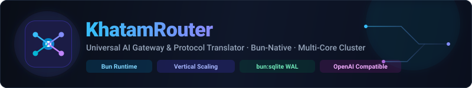
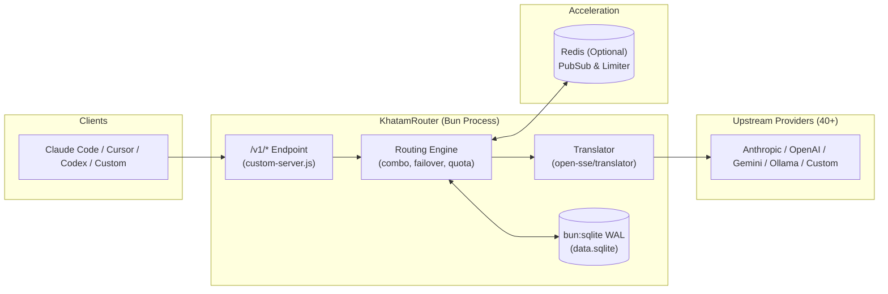

<div align="center">
  
  <br/>

  # KhatamRouter

  **High-Performance AI Routing Gateway, Vertical Scale Engine & Protocol Translator**

  Connect any AI developer tool or client to 40+ AI providers through one unified, high-concurrency OpenAI-compatible endpoint.

  [](./LICENSE)
  [](https://bun.sh)
  [](#-how-this-fork-differs)
  [](#-how-this-fork-differs)
  [-DC382D.svg?logo=redis&logoColor=white)](#-how-this-fork-differs)
  [-10b981.svg)](#-connecting-clients)

  [Why KhatamRouter](#-why-khatamrouter) • [Architecture](#-architecture) • [Comparison](#-how-this-fork-differs) • [Features](#-key-features) • [Quick Start](#-quick-start) • [Configuration](#-configuration) • [Clients](#-connecting-clients) • [Credits](#-credits-and-lineage)

</div>

---

## 💡 Why KhatamRouter

KhatamRouter sits between your AI developer clients (Claude Code, Cursor, Codex, OpenCode, Cline) and upstream model providers. It acts as an intelligent, high-concurrency proxy that handles protocol translation, model combo routing with automatic failover, multi-account rotation, OAuth and API-key credential management, automatic background token refresh, and usage tracking.

Unlike traditional single-process Node proxies, KhatamRouter is designed for **Bun-native execution and multi-core vertical scaling**:

- **Bun-Only Execution**: Built strictly around `bun:sqlite` with WAL mode and zero Node database fallback dependencies.
- **Multi-Process Concurrency**: A cluster supervisor automatically provisions workers across host CPU cores to saturate high-throughput local AI workloads.
- **Fail-Safe Acceleration**: Hot-path in-memory LRU caching and optional Redis pub/sub clustering with transparent single-process fallback.
- **Hardened Ingestion**: Smuggling mitigation, sliding-window tool loop protection, and fail-closed vision capability routing.

For implementation milestones and planned work, see [ROADMAP.md](./ROADMAP.md). For release notes, see [CHANGELOG.md](./CHANGELOG.md).

---

## 📐 Architecture

KhatamRouter exposes one OpenAI-compatible `/v1/*` endpoint and translates requests to any supported upstream format (OpenAI, Anthropic Claude Messages, Google Gemini) via a direct or intermediate routing engine.



For full details on the request lifecycle, token refresh loops, and persistence model, see [docs/ARCHITECTURE.md](./docs/ARCHITECTURE.md) and [open-sse/AGENTS.md](./open-sse/AGENTS.md).

---

## ⚖️ How This Fork Differs

KhatamRouter is initialized from [decolua/9router](https://github.com/decolua/9router) and adapts provider definitions and stateless executors from [Vanszs/VansRouter](https://github.com/Vanszs/VansRouter). Every comparison below is derived directly from and verifiable in this repository's codebase.

| Subsystem / Feature | KhatamRouter | Upstream 9router | VansRouter | Repo Evidence |
|---|---|---|---|---|
| **Runtime Engine** | Strict Bun runtime (`process.versions.bun` enforced; Node drivers removed) | Multi-driver Node fallback chain (`better-sqlite3`, `node:sqlite`, `sql.js`) | Node.js (`engines.node`, pnpm packaging) | `src/lib/db/driver.js:24-25` |
| **Persistence Driver** | `bun:sqlite` exclusively with WAL journal mode | Multi-driver Node fallback chain | `better-sqlite3` / `node:sqlite` | `src/lib/db/adapters/bunSqliteAdapter.js:1-16` |
| **Process Model & Scaling** | `node:cluster` supervisor running `max(1, nproc - 2)` workers (`KHATAM_WORKERS`) | Single-process | Single-process | `src/lib/cluster/supervisor.js:20-33` |
| **Distributed Coordination** | Optional Redis Pub/Sub events & distributed login rate limiter | None (in-process only) | In-process `Map`s for combo state and failures | `src/lib/redis/events.js:1-28`, `src/lib/auth/loginLimiter.js:1-26` |
| **Hot-Path Repository Caches** | 5-second TTL in-memory LRU caches for aliases, combos, and nodes | None | None | `src/lib/db/repos/aliasRepo.js:14`, `src/lib/db/repos/combosRepo.js:10`, `src/lib/db/repos/nodesRepo.js:10` |
| **Worker Secret Convergence** | Atomic file locking via hard-link collision (`publishSecretOnce`) | Single-process file write | Single-process file write | `src/shared/utils/secretFile.js:9-26`, `src/lib/auth/dashboardSession.js:22` |
| **Request Ingestion Hardening** | Rejects combined `Content-Length` + `Transfer-Encoding`; 64 MiB chunked cap | Default HTTP parsing | Rejects combined `Content-Length` + `Transfer-Encoding`; 64 MiB chunked cap | `custom-server.js:164`, `custom-server.js:310-336` |
| **Model Capability Gating** | Fail-closed vision requirement enforcement (`KHATAM_MODEL_CAPABILITY_GUARD=1`) | None | None | `src/domain/requestCapabilities.js:16`, `open-sse/services/combo.js:525` |
| **Granular Quota & Cost Ledger** | Per-key spend caps & transactional `request_cost_ledger` table | No `request_cost_ledger` table | No `request_cost_ledger` table | `src/domain/keyQuota.js:1-25`, `src/lib/db/keyQuota.js:1-24` |
| **LoopGuard** | Opt-in sliding-window loop detection (`loopGuardEnabled`) | Not present | Present (`open-sse/handlers/chatCore.js`) | `open-sse/utils/loopGuard.js:1-30`, `src/lib/db/repos/settingsRepo.js:71` |
| **Rotating Psiphon Proxy Pool** | `psiphon` pool type: holds a lowest-latency tunnel, rotates to a new IP and country on 429 / `FreeTierError` / transport failure; fail-closed (never falls back to the server IP). Operator supplies the GPL-3.0 `ConsoleClient` | Static proxy URLs only | Static proxy URLs only | `src/lib/network/psiphon/psiphonManager.js`, `docs/PSIPHON.md` |

---

## ⚡ Key Features

- **🚀 Multi-Core Vertical Scaling**: Automatically scales across physical cores via `node:cluster` supervisor (`KHATAM_WORKERS`, default `max(1, nproc - 2)`). Hot-path alias, combo, and node lookups use 5-second in-memory LRU caches with automatic invalidation.
- **🔀 Unified Multi-Modal Gateway**: Connect any OpenAI-compatible client to 40+ providers via `/v1/*` endpoints (`chat/completions`, `messages`, `responses`, `embeddings`). Format translation bridges OpenAI, Anthropic Claude, and Google Gemini schemas.
- **🛡️ Hardened Request Ingestion**: Rejects malformed requests combining `Content-Length` and `Transfer-Encoding` to eliminate request smuggling, and enforces a 64 MiB ceiling on chunked payloads in `custom-server.js`.
- **👁️ Fail-Closed Capability Guard**: Protects multi-modal workflows by rejecting vision requests when no target in a combo confirms vision support, activated via `KHATAM_MODEL_CAPABILITY_GUARD=1`.
- **💳 Per-Key Spend Limits & Cost Ledger**: Configure granular spend limits per API key across daily, weekly, and monthly UTC accounting windows, backed by a persistent `request_cost_ledger` table.
- **🌐 Rotating Psiphon Proxy Pool**: Keeps OpenCode Free (or any pool-bound provider) off flagged IPs: holds a lowest-latency Psiphon tunnel and rotates to a new IP and country on 429 / `FreeTierError` / transport failure. Fail-closed, operator-supplied GPL-3.0 sidecar, see `docs/PSIPHON.md`.
- **🔁 LoopGuard Protection**: Detects repetitive tool-calling cycles and repeating assistant messages using an opt-in sliding window in `open-sse/utils/loopGuard.js`.
- **🔐 Resilient Persistence & Clustering**: Zero-dependency `bun:sqlite` with WAL mode and preflight integrity validation. Optional Redis provides cross-worker event broadcasting and distributed progressive login limiting.
- **📊 Real-Time Dashboard**: Web interface for API keys, model combos, provider nodes, OAuth authentication, usage metrics, and CLI tooling integration.

---

## 🚀 Quick Start

### Option 1: Prebuilt Docker image (Recommended, nothing to build)

```bash
docker compose -f docker-compose-prod.yml up -d
```

`docker-compose-prod.yml` pulls the `ghcr.io/rqzbeh/khatamrouter:edge` image that CI publishes from every green `master` (amd64 and arm64), starts Redis and the Headroom sidecar next to it, and publishes the gateway on port `20128`. The web dashboard is accessible at `http://localhost:20128/dashboard`.

To build the image yourself instead, run `docker compose up -d`: `docker-compose.yml` builds from `Dockerfile.bun`.

<details>
<summary><b>Docker Deployment Details & Operational Commands</b></summary>

- Standalone container configurations and persistent volume details live in [DOCKER.md](./DOCKER.md).
- To view live container logs:
  ```bash
  docker compose logs -f
  ```
- To shut down the services:
  ```bash
  docker compose down
  ```
- Persistent data is stored in the Docker volume mounted at `/app/data`.
</details>

### Option 2: From Source

Bun is required. Node.js is not supported.

```bash
bun install

# Build for production and start the multi-worker cluster on port 20128
bun run build:bun
PORT=20128 bun run start:bun
```

Open `http://localhost:20128/dashboard` in your browser.

<details>
<summary><b>Development Server Details</b></summary>

For local gateway development with hot module reloading:

```bash
# Starts development server (hardcoded to port 20127)
bun run dev:bun
```

- Development dashboard: `http://localhost:20127/dashboard`
- Development API endpoint: `http://localhost:20127/v1`
</details>

### Option 3: Local CLI Launcher

The `cli/` directory contains an independent CLI launcher:

```bash
cd cli && bun run build
```

Run from `cli/app/`. Global installation via a future KhatamRouter-specific package is planned.

---

## ⚙️ Configuration

Configure the gateway using environment variables:

```bash
cp .env.example .env
```

> ⚠️ **Security Warning**: Set strong values before exposing the gateway. Defaults are not safe for shared or networked deployments. `INITIAL_PASSWORD` in `.env.example` is `change-me`, and the login route falls back to `123456` if it is unset (`src/app/api/auth/login/route.js:58`). `API_KEY_SECRET` falls back to a built-in string when empty (`src/shared/utils/apiKey.js:3`).

| Variable | Default | Description |
|---|---|---|
| `INITIAL_PASSWORD` | `change-me` | Dashboard login password. Must be changed before public exposure. |
| `JWT_SECRET` | Auto-generated | Session cookie signing key. A random secret is generated under `DATA_DIR` if empty. |
| `API_KEY_SECRET` | Built-in fallback | HMAC secret used to sign and verify gateway API keys. Set explicitly. |
| `PORT` | `20128` | Listener port for production (`custom-server.js:15`). |
| `DATA_DIR` | `~/.9router` | Root storage directory (`/app/data` in Docker Compose). |
| `REDIS_URL` | None | Optional Redis connection string (e.g. `redis://localhost:6379`). |
| `KHATAM_WORKERS` | `max(1, nproc - 2)` | Worker process count for vertical scaling (clamped 1–64). |

The complete environment variable contract is defined in [`.env.example`](./.env.example).

---

## 🔌 Connecting Clients

- **Base URL**: `http://localhost:20128/v1` (production) or `http://localhost:20127/v1` (development)
- **Dashboard**: `http://localhost:20128/dashboard` (or port `20127` in dev mode)
- **API Keys**: Generated on the dashboard's Endpoint page (`src/app/(dashboard)/dashboard/endpoint/`).

### Test with cURL

```bash
curl http://localhost:20128/v1/chat/completions \
  -H "Content-Type: application/json" \
  -H "Authorization: Bearer YOUR_API_KEY" \
  -d '{
    "model": "YOUR_MODEL_OR_COMBO",
    "messages": [{"role": "user", "content": "Hello"}]
  }'
```

### Claude Code CLI

```bash
export ANTHROPIC_BASE_URL="http://localhost:20128"
export ANTHROPIC_AUTH_TOKEN="YOUR_API_KEY"
claude
```

Any OpenAI-compatible or Anthropic-compatible tool (Cursor, OpenCode, Codex, Cline, Roo Code) can connect directly using the base URL. Upstream provider definitions live in `open-sse/providers/registry/`.

---

## 📚 Documentation

- [ROADMAP.md](./ROADMAP.md) — Implementation status, architectural phases, and planned work.
- [CHANGELOG.md](./CHANGELOG.md) — Release notes and version history.
- [docs/ARCHITECTURE.md](./docs/ARCHITECTURE.md) — Request lifecycle, format translation, and storage architecture.
- [docs/PERFORMANCE.md](./docs/PERFORMANCE.md) — Multi-core vertical scaling benchmarks.
- [DOCKER.md](./DOCKER.md) — Container deployment guide and volume configuration.
- [CLAUDE.md](./CLAUDE.md) — Contributor instructions and agent conventions.

---

## 🎖️ Credits and Lineage

- **[decolua/9router](https://github.com/decolua/9router)**: KhatamRouter is initialized from 9router and ports later upstream releases. The routing engine, dashboard, provider interfaces, and CLI originate there. MIT License.
- **[Vanszs/VansRouter](https://github.com/Vanszs/VansRouter)**: Provider definitions, stateless executors, LoopGuard, and free-tier discovery were adapted from VansRouter to this Bun-only, Redis-optional architecture. KhatamRouter does not share git history with VansRouter. MIT License.

Both projects are MIT-licensed. The copyright notice is preserved in [LICENSE](./LICENSE): Copyright (c) 2024-2026 decolua and contributors.
